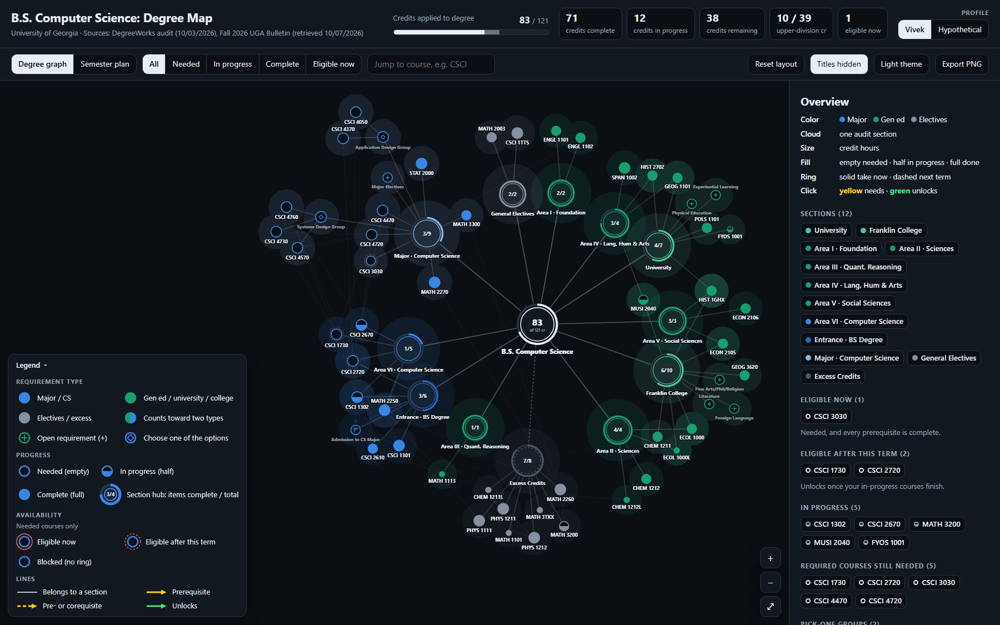
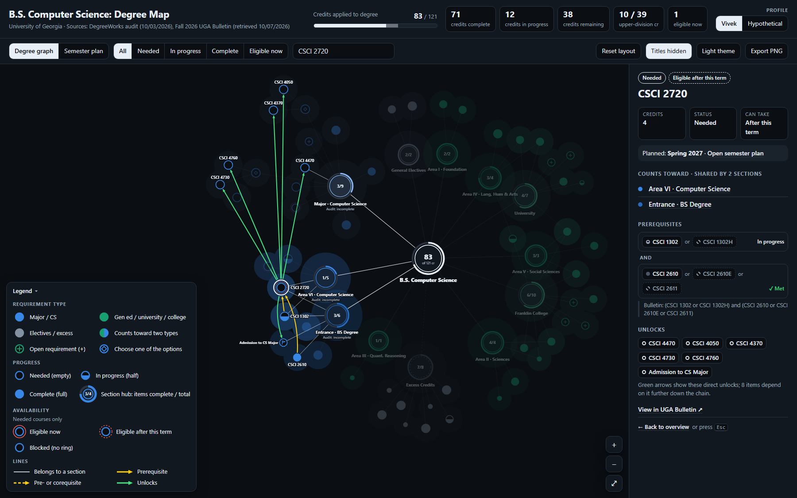
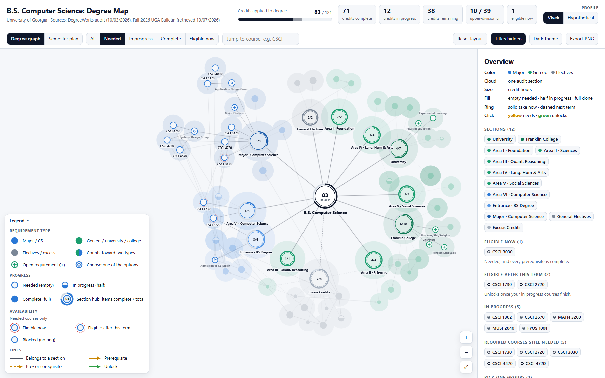
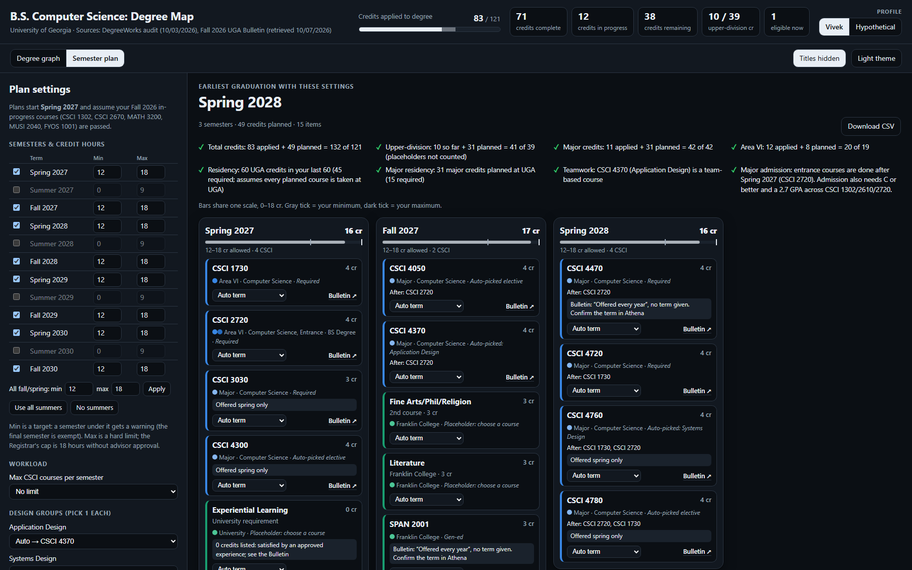
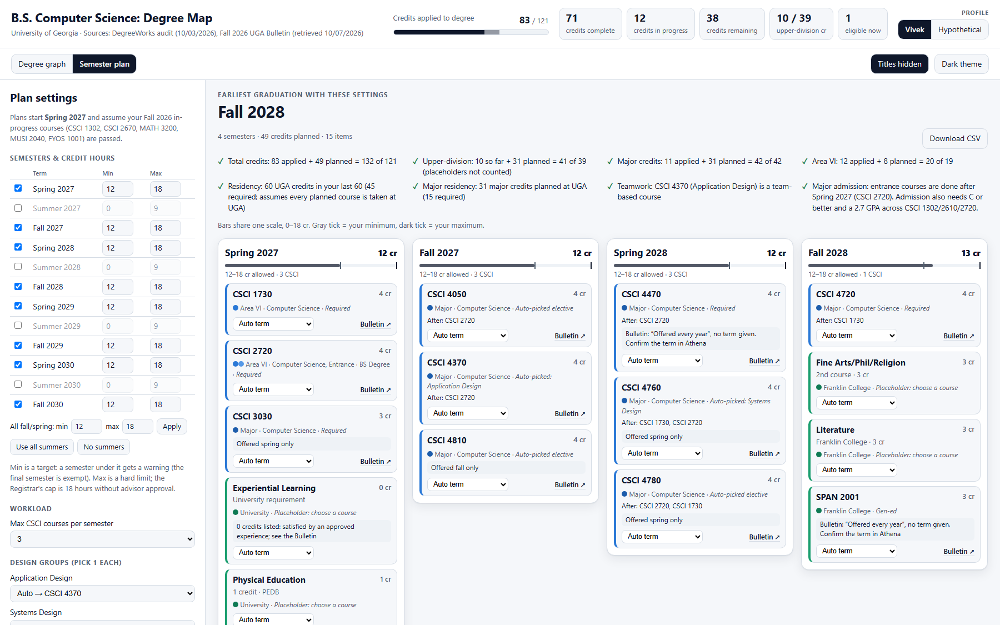

# Degree Map: UGA B.S. Computer Science

An interactive, single-file web page that turns a DegreeWorks audit into two things:

1. **Degree graph:** an Obsidian-style knowledge graph of the whole degree. Every course and requirement is a node, every audit section is a cluster colored by requirement type (major, gen ed, electives), and clicking a course shows what it needs and what it unlocks.
2. **Semester plan:** a scheduler that finds the earliest possible graduation given your credit limits, then lays out every remaining course semester by semester.

Everything runs locally in the browser from one HTML file. No install, no server, no build step, and no data leaves your machine.



> Screenshots in this README use the page's **Redact titles** mode, which hides course titles. Section names, course codes and statuses are still visible.

---

## Contents

- [Quick start](#quick-start)
- [Using the degree graph](#using-the-degree-graph)
- [Using the semester planner](#using-the-semester-planner)
- [How it is made](#how-it-is-made)
- [Tech stack](#tech-stack)
- [Project structure](#project-structure)
- [Accuracy, assumptions and limitations](#accuracy-assumptions-and-limitations)
- [Privacy](#privacy)
- [Future plans](#future-plans)

---

## Quick start

1. Download or clone this repository.
2. Double-click **`degree-map.html`**. It opens in any modern browser (Chrome, Edge, Safari, Firefox).

That's it. The page has no dependencies and works offline. The only network links are the optional "View in UGA Bulletin ↗" links, which open public course pages when you click them.

Use the toggle at the top left to switch between **Degree graph** and **Semester plan**. Your theme, redaction, view and planner settings are remembered in the browser (`localStorage`).

### Profiles

The **Profile** switch at the top right picks whose data is shown. Both profiles are hard-coded in the page and share the same degree structure and Bulletin prerequisites:

- **Vivek:** the real DegreeWorks audit dated 10/03/2026 (personal identifiers removed).
- **Hypothetical:** a fictional junior with Data Structures in progress, built so every legend case appears at least once: all three requirement types plus a course split across two, complete/in-progress/needed items, open requirements (one complete), both pick-one groups, courses eligible now / after this term / blocked, and prerequisite chains several levels deep.

Switching saves the choice and reloads the page. Planner settings are saved separately for each profile. The planner's degree checks (upper-division, major and Area VI credits) are computed from the selected profile's data.

---

## Using the degree graph

### Reading the graph

Each visual property has exactly one meaning:

| Property | Meaning |
|---|---|
| **Color** | Requirement type: **blue** = major / CS (Major, Area VI, Entrance), **green** = gen ed / university / college (Areas I–V, University, Franklin College), **gray** = electives / excess. Sections of the same type use lighter or darker shades of one hue. An item that counts toward two types is split between both colors. |
| **Fill** | Progress: **empty** = needed, **half** = in progress, **full** = complete. |
| **Thin red outer ring** | Eligibility, shown only on courses you still need: **solid** = eligible now, **dashed** = eligible after this term, **no ring** = blocked. |
| **Size** | Credit hours: circle area is proportional to credits (a 4-cr course has 4× the area of a 1-cr course). |
| **Inner symbol** | Node kind: **none** = course, **+** = open requirement (e.g. Literature, Major Electives), **◇** = pick one (Application Design, Systems Design), **flag** = milestone (Admission to CS Major). Outlines are always solid. |
| **Lines** | A thin **white line** (dark in light mode) links a course to its section, a section to the degree, and a pick-one group to its options. Prerequisite arrows are hidden until you click a course: then **yellow** arrows show what it needs and **green** arrows what it unlocks. A **solid** arrow is a prerequisite (finish it in an earlier term; "one of several" alternatives included). A **dashed** arrow is a pre- or corequisite (take it before or in the same term). The side panel lists the full AND/OR groups. |

| Element | Meaning |
|---|---|
| **Center node** | The degree. Its ring and number both show credits applied, including this term's in-progress courses (83 of 121 for Vivek). |
| **Hub nodes** | The 12 audit sections, larger than courses, each in a soft cloud of its section color. The thick ring and the number inside both show items complete / total. |
| **Shared courses** | A course that counts toward more than one section is pulled between those hubs, so it sits where their clouds overlap. Its tooltip lists every section. |

**Progressive disclosure:** at overview zoom, the graph emphasizes requirement type, progress, hubs and course codes. Audit text, eligibility rings and open-requirement labels stay faint until you hover, select or zoom in (about 110%+). Prerequisite arrows are hidden entirely until you click a course; then only that course's arrows appear.

The **Overview** panel on the right opens with a six-line key (color, cloud, size, fill, ring, click) for reading the graph at a glance.

### Interacting

- **Hover** a node: nearby nodes wobble and settle back, its section links light up and everything else fades. A tooltip shows code, credits, status and sections. Its label appears too if it was hidden to avoid overlap.
- **Click** a course to trace it. Only direct links are shown, one step each way: **yellow** arrows come from the courses it needs (solid = prerequisite, dashed = pre- or corequisite), **green** arrows go to the courses (and pick-one groups) it unlocks. Click one of those to follow the chain a step further. Arrows stop just outside the selection ring and are straight, bending only to avoid passing through another highlighted node. The side panel shows:
  - credits, status and whether you can take it now
  - which sections and requirement lines it counts toward
  - its prerequisites as AND/OR groups, each marked *Met / In progress / Not met*, plus the exact Bulletin wording
  - what it directly unlocks, and how many more items depend on it further down the chain
  - its planned semester (from the planner) and a link to its Bulletin page
- **Click** a section hub to see its requirements, the audit's notes, and which of its courses are shared with other sections.
- **Drag** nodes to rearrange; **Reset layout** restores the original arrangement.
- **Scroll** to zoom, drag the background to pan, or use the **+ / − / ⤢** buttons.



### Toolbar

| Control | What it does |
|---|---|
| **All / Needed / In progress / Complete / Eligible now** | Fades everything that doesn't match. |
| **Search** | Type a code (e.g. `CSCI 2720`) or a requirement name and press Enter to jump to it. |
| **Reset layout** | Re-runs the force layout from its starting positions. |
| **Redact titles** | Hides course titles and audit requirement-line names everywhere (graph, panel, planner, CSV), for screenshots and demos. |
| **Light / Dark theme** | Switches theme. |
| **Export PNG** | Saves what's on screen as a 2× PNG, with a title, a one-line key and the data sources added so the image makes sense on its own. |

**Keyboard:** `/` search · `F` fit to screen · `+` / `-` zoom · `Esc` clear selection.



---

## Using the semester planner

The planner schedules everything still required and reports the **earliest graduation semester** your settings allow.



### What it schedules

What gets scheduled comes from the selected profile's open requirements. For **Vivek**:

- **Required courses still needed:** CSCI 1730, 2720, 3030, 4470, 4720.
- **Design groups:** one Application Design course (CSCI 4050 or 4370) and one Systems Design course (CSCI 4730, 4760, or 4570).
- **Major electives:** 12 credits of CSCI 4000-level courses (not CSCI 4150).
- **Gen-eds:** SPAN 2001 for the foreign-language requirement, plus placeholders for Literature (3 cr), the second Fine Arts/Philosophy/Religion course (3 cr), PE (1 cr) and Experiential Learning (0 cr).

The **Hypothetical** student has less left (graduating Fall 2027 by default) and only open requirements it hasn't already met. Electives a student has already taken are never suggested.

The planner assumes the Fall 2026 in-progress courses are passed and starts planning in **Spring 2027**.

### Settings (left column)

| Setting | Details |
|---|---|
| **Semesters & credit hours** | Turn any term from Spring 2027 to Fall 2030 on or off, and set its **min** and **max** credits. Max is a hard limit. Min is a target: a semester under it gets a warning, except the final one. Defaults are 12–18 for fall/spring (18 is the Registrar's cap without advisor approval); summers are off by default with a 0–9 range. Quick buttons set all fall/spring terms at once and turn every summer on or off. |
| **Max CSCI courses per semester** | Optional cap (2, 3 or 4) to spread out heavy CS terms. |
| **Design groups** | *Auto* lets the planner pick the best fit, or choose a specific course. |
| **Major electives** | Auto-picked from **regularly offered** courses whose prerequisites fit your plan. Change any dropdown to lock in a specific course, or use **+ Add a specific elective**. Every CSCI 4000-level course in the Bulletin is listed; ones you can't take (e.g. a prerequisite outside the plan) are disabled with the reason. |
| **Gen-ed requirements** | Include or leave out each one. |
| **Locked semesters** | Every course card has a term menu to lock it to a semester. Impossible locks are explained, e.g. *"CSCI 4720 is locked to Spring 2027, but CSCI 1730 must be finished first, so Fall 2027 is the earliest it can go."* |

### The plan (right side)

- **Earliest graduation** plus semester count and credits planned.
- **Degree checks:** total credits (121), upper-division (39), major credits (42), Area VI (19), each computed from the selected profile's data, residency (45 of the last 60 at UGA), major residency (15), teamwork course, and when the major-admission courses will be done.
- **Warnings:** semesters under your minimum, over 18 hours, or a search that hit its time limit.
- **Semester columns**, each with a credit bar (every bar uses the same scale, with ticks at that term's min and max), and a card per course showing:
  - the sections it counts toward and its role (required, auto-picked, your elective, placeholder); CSCI courses have a dark left edge
  - the in-plan prerequisites it waits on ("After: …")
  - offering flags: *fall only*, *spring only*, *"Offered every year" (no term given): confirm in Athena*, *not offered on a regular basis*, *cross-listed*
  - a lock menu and a Bulletin link
- **Download CSV** exports the plan (term, course, title, credits, what it counts toward, notes).



### How "optimal" is decided

1. **Fewest semesters.** The planner proves no shorter plan exists before accepting a longer one.
2. **Meet your minimum credits** in every semester but the last, where possible.
3. **Gateway courses early.** Courses that other planned courses depend on (e.g. CSCI 1730, 2720) go as early as possible, so retaking one doesn't push back graduation.
4. **Even credit loads.**
5. **Prefer electives offered in more than one season.**

---

## How it is made

### 1. Requirement data (from the DegreeWorks audit)

The page holds two hard-coded profiles that share one degree structure and one Bulletin prerequisite table. Each profile has the same five constants (`VIVEK_COURSES`, `HYPO_COURSES` and so on), gathered in `PROFILES`; the selected one is unpacked into the names below at load.

**Vivek** comes from a real audit, exported by hand from DegreeWorks as a PDF. Its text was extracted with `pdfplumber` (Python) and transcribed into structured constants at the top of the page's script. **Hypothetical** is written by hand, using real Bulletin prerequisites, so every legend case appears at least once.

- `COURSES`: code, title, credits, status (`complete` / `in_progress` / `needed`).
- `REQS`: open requirements without a fixed course (Literature, Major Electives, Admission to the major…). One can be marked complete.
- `CHOICES`: pick-one groups.
- `BLOCKS`: the 12 audit sections, each with its items and the audit's requirement line, credit totals and notes.
- `DEGREE`: degree-level checks.

**Only** course codes, titles, credits, statuses and requirement names were kept. Name, student ID, GPA, grades, terms and transfer sources were discarded. Section status is **derived in code** from its items (all complete → complete; some started → in progress; none started → needed), not copied from the audit. The page computes credits applied itself (Vivek: 71 complete + 12 in progress = 83; Hypothetical: 75 + 17 = 92) and warns in the console if that doesn't match the audit.

### 2. Prerequisite and offering data (from the UGA Bulletin)

The audit doesn't contain prerequisite chains, so those come from the public [UGA Bulletin](https://bulletin.uga.edu):

- Course detail pages were fetched with `curl` and parsed with Python. The fields used are *Prerequisite / Undergraduate Prerequisite*, *Pre or Corequisite*, *Corequisite*, *Semester Course Offered* and credit hours.
- Prerequisite text such as `(CSCI 1302 or CSCI 1302H) and (CSCI 2610 or CSCI 2610E or CSCI 2611)` is parsed by a small recursive-descent parser into **AND-of-OR groups** (conjunctive normal form). Cross-listed codes like `CSCI(MATH) 2610` are normalized. "Permission of department" alternatives are dropped, so the planner never assumes permission.
- The planner's catalog (`PLAN_CATALOG`: every CSCI 4000-level course plus a few others) is **generated** from that parsed data, not typed by hand. The graph's prerequisite table (`PRE`) was transcribed from the same fetched Bulletin text. Both keep the Bulletin's exact wording for display.

### 3. The degree graph

- **Rendering:** hand-written **SVG**, no charting library. Colors are literal values from a per-theme palette, so the exported PNG looks exactly like the screen. Each visual property has one job: **color** = requirement type (blue / green / gray, with related sections as lighter or darker shades of one hue), **fill** = progress, a thin **red ring** = eligibility, **size** = credit hours, an **inner symbol** (+, ◇, flag) = node kind, and a **trace pair** (yellow = needs, green = unlocks) shown only while a course is selected. The section and trace colors were checked for color-vision deficiency in both themes.
- **Layout:** a custom **force-directed simulation**, modeled on d3-force but written from scratch:
  - **Springs:** degree→section, section→item, choice→option, and weak prerequisite springs. Link strength is split by how many sections an item belongs to, which is what places shared courses between hubs.
  - **Forces:** many-body repulsion, collision with label padding, and weak centering gravity.
  - **Spacing:** courses repel harder and keep more clearance than hubs, so outer clusters stay readable.
  - **Stagger:** partway through settling, each hub's courses are sorted by angle and alternate between a nearer and a farther distance, so a cluster reads as a gentle zig-zag instead of a crowded arc.
  - **Start:** a seeded random generator gives the same layout every load, and the simulation pre-settles for 380 steps before the first draw.
- **Clusters:** one translucent group of circles per section, in that section's shade; overlapping groups blend where sections share courses.
- **Labels:** a greedy declutter pass places labels in priority order (selected/hovered, then needed, in progress, complete). Each tries below, above, right, then left of its node, skipping any spot that overlaps another label, a node, or a highlighted trace arrow; if none is free it stays hidden until hovered. Arrows stop just outside a node's outermost ring (selection, eligibility or hub progress ring). Section and degree labels are always shown.
- **Legend:** four sections (requirement type, progress, availability, lines). *Lines* has four entries: section line, prerequisite (solid yellow), pre- or corequisite (dashed yellow) and unlocks (green). Circle size = credit hours is explained in the overview panel and the exported PNG key. Its examples are drawn by the same functions as the graph, so they match exactly. It never grows taller than the graph area: the contents scroll and the header stays pinned, so it can always be closed.
- **Arrows:** shown only for the clicked course. Each is a straight line unless it would pass through another highlighted node; then it bows just enough to go around, trying a shallow bend on either side before a deeper one. A traced pick-one link becomes a green arrow from the course to its group, matching the side panel's *Unlocks* list. *Fit to screen* reserves room for it (on the left or along the bottom, whichever leaves a bigger graph), and it starts collapsed on small screens.
- **Hover wobble:** a separate damped spring per node, so nodes wobble and always return to where the layout put them. It runs at a fixed ~60 Hz step so motion looks the same on any refresh rate, and turns off under `prefers-reduced-motion`.
- **Eligibility:** computed with plain logic, no AI. A needed course is *eligible now* if every prerequisite group contains a completed course, and *eligible after this term* if every group has a completed or in-progress one.

### 4. The semester planner

- **Inputs:** remaining requirements become plan items with credits, allowed seasons, prerequisite groups (must be an earlier term) and pre-/corequisite groups (same term or earlier).
- **Candidate plans:** one per combination of design-group choices and auto-picked electives, 80 with default settings.
- **Exact search:** for each candidate, a **depth-first search** finds the fewest semesters, starting from proven lower bounds:
  - each course's earliest possible term (prerequisite order + offered seasons + locks)
  - total credits vs. capacity
  - CSCI count vs. the per-semester cap

  It prunes on remaining capacity and on how many prerequisite steps are still needed below each course.
- **Refinement:** a **local search** (single moves and swaps) improves the plan in order: under-minimum credits, then gateway lateness, then load variance. It never adds a semester.
- **Diagnostics:** impossible locks are explained before searching. A global time cap guarantees the page stays responsive; typical solves take **under 50 ms**.

### 5. How it was verified

- **Graph:** every node drawn; checked programmatically for overlapping nodes and for edges passing through nodes.
- **Credit totals:** recomputed in code and matched against the audit (83 applied, 21 excess).
- **Planner:** 15 scenarios (credit caps, CSCI caps, summers, specific design choices, cross-listed and irregular electives, locks, impossible settings), each checked by a **separate Python validator** with prerequisites and offerings typed by hand from the Bulletin. All workable plans passed, impossible setups were rejected with the right reason, and each graduation term was confirmed by hand to be the earliest possible.

---

## Tech stack

| Layer | Technology |
|---|---|
| Page | One self-contained **HTML5** file (`degree-map.html`), about 165 KB |
| Styling | **CSS** with custom properties for light/dark themes, Grid and Flexbox, with a stacked layout for narrow screens |
| Logic | **Vanilla JavaScript** (ES2020+), wrapped in one module-like IIFE. No frameworks, no dependencies, no build step |
| Graph rendering | Hand-built **SVG** (`createElementNS`), custom force-directed layout and damped-spring hover physics |
| Planner | Custom exact **depth-first search** with lower-bound pruning plus **local-search** refinement |
| Export | SVG → `<canvas>` → **PNG** (graph); Blob → **CSV** (plan) |
| Persistence | `localStorage` for preferences (wrapped in try/catch; the page works without it) |
| Fonts | System font stack (`-apple-system`, Segoe UI, Roboto…) |
| Data prep (offline) | **Python 3** with **pdfplumber** (audit text), **curl** (public Bulletin pages), a custom prerequisite-text parser |
| Screenshots | Headless **Google Chrome** |

---

## Project structure

```
DegreePrototype/
├── degree-map.html            # the whole app: data, graph, planner, styles
├── degreeworks-graph-mvp.md   # original project brief
├── docs/
│   └── screenshots/           # images used in this README (titles redacted)
├── README.md
└── .gitignore                 # keeps the raw audit PDF and other personal data out of git
```

The script inside `degree-map.html` is organized top to bottom:

1. `DATA` (the two profiles + Bulletin prerequisites)
2. `MODEL` (statuses, edges, eligibility)
3. `THEME`
4. `FORCE SIMULATION`
5. `RENDERING`
6. `STATE` (selection, filter, hover)
7. `PAN / ZOOM / DRAG`
8. `SIDE PANEL`
9. `SEMESTER PLANNER` (catalog, solver, UI)

---

## Accuracy, assumptions and limitations

- **Not an official audit.** This is a planning aid; confirm everything with your advisor and in DegreeWorks/Athena before registering.
- **Hypothetical is fictional.** It is sample data for demos and testing, not a real student. A few of its gen-ed courses are plausible stand-ins without a Bulletin page, so they have no Bulletin link.
- **Snapshots in time:** Vivek's data reflects the DegreeWorks audit dated **10/03/2026** and the UGA Bulletin as retrieved **10/07–10/13/2026**. It does not update itself.
- **Offerings:** the Bulletin's *Semester Course Offered* is a general pattern, not a guarantee that a section exists in a given term.
  - Courses listed as "Offered every year" without a term (e.g. CSCI 4470, SPAN 2001) are placed in fall or spring and flagged.
  - Courses "not offered on a regular basis" are never auto-picked, but you can add them.
- **Prerequisite arrows** are drawn only between courses in your audit. Other accepted alternatives (honors and online versions, etc.) appear as dashed chips in each course's details.
- **Placeholders:**
  - Literature, Fine Arts and PE are generic slots. Pick real courses from the Bulletin lists. They aren't counted toward upper-division credit.
  - Experiential Learning is treated as 0 credits. The audit gives no credit amount; it's satisfied by an approved experience.
- **Cross-listed electives** (e.g. MATH(CSCI) 4670) are flagged: confirm with your advisor that they count as CSCI electives.
- **Admission to the major** requires grades (C or better, 2.7 GPA across CSCI 1302/2610/2720) that the planner can't predict; it only reports when the courses will be done.
- **Bulletin wording is shown as written.** For example, CSCI 4760's prerequisite text ends with a stray `))`, and CSCI 4280's text requires both CSCI 2720 *and* 2720E. Because of that literal wording, CSCI 4280 shows as unavailable.
- **Label crowding:** in dense clusters some labels (mostly completed courses) are hidden to avoid overlap; hover a node or zoom in to see them.

---

## Privacy

Following the project brief:

- **No automation against university systems.** DegreeWorks and Athena were never scraped or driven by a script; the audit was exported by hand. Only the public Bulletin was fetched.
- **No credentials** are requested, stored or handled.
- **Personal identifiers stripped.** Apart from the first-name profile label, the page contains no name, student ID, GPA, grades or terms.
- **Local only.** No analytics, no CDN, no network calls carrying data.
- **No AI in the logic.** Statuses, eligibility and the schedule are computed by plain code.
- The raw audit PDF is excluded by `.gitignore`. **Redact titles** mode is available for anything shared publicly.

---

## Future plans

**Data and generality**
- [ ] Commit the data-prep tooling (`tools/`): the audit text extractor, the Bulletin fetcher and the prerequisite parser, so the data can be regenerated.
- [ ] `parse_audit.py` + a separate `data/graph.json` and `data/prereqs.json` (as described in the original brief), so any student's exported audit can be loaded without editing code.
- [ ] Support other majors and degrees by loading requirement blocks from the parsed audit instead of hard-coding them.
- [ ] One-click refresh of Bulletin data for a new catalog year.

**Planner**
- [ ] "What-if" mode: simulate failing or withdrawing from a course and see how graduation moves.
- [ ] Choose actual courses for Literature / Fine Arts / PE from the Bulletin's attribute lists.
- [ ] Recognize double-counting rules (one course satisfying several gen-ed attributes).
- [ ] Optional free-elective filler to keep every semester full-time.
- [ ] Manually enter real section availability per term (no scraping of Athena; by hand only).
- [ ] Export the plan to PDF / calendar.

**Graph and UI**
- [ ] Animate the graph semester by semester following the plan ("watch the degree fill in").
- [ ] Better label placement in dense clusters.
- [ ] Full keyboard navigation and screen-reader descriptions for the graph.
- [ ] Mobile and touch polish (pinch-zoom).

**Engineering**
- [ ] Split the single file into modules (`data/`, `graph/`, `planner/`) with a tiny build step, keeping a single-file release.
- [ ] Automated tests for the prerequisite parser, eligibility rules and the solver (including the independent validator used during development).

---

*Built as a personal prototype by V3RT3X Solutions. Not affiliated with or endorsed by the University of Georgia or Ellucian (DegreeWorks).*
